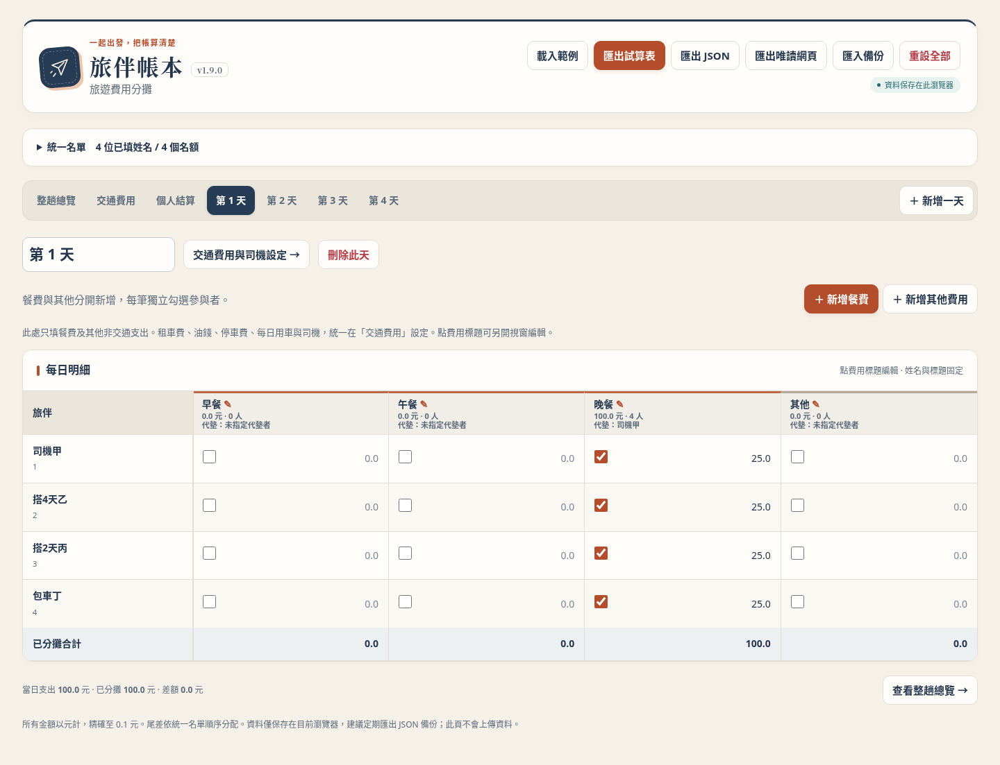

# 旅伴帳本 v1.9.0：HTML 記帳、Google 試算表分享

頁面主標題、瀏覽器分頁、唯讀分享網頁與 XLSX 報表均顯示 **v1.9.0**。本版新增每筆費用「按人數／按組數」，可逐一勾選要出錢的代表。也直接顯示代墊者，並在個人結算區分「預收團費」「代墊」「待退款」。租車優惠為額外收入，不能扣掉代墊者實際支付的金額。

你在 HTML 填費用、勾參與者，工具完成分攤後匯出 `.xlsx`，再用 Google 試算表分享給旅伴看。不需要登入網頁、後端、外部 API、CDN 或 Apps Script。

介面採暖白、藏青、陶橘與湖水藍的旅遊手帳風格，搭配紙飛機標誌、分色結算卡片與精簡表格。以下畫面使用示範帳目；第一次開啟仍是空白帳本。



[查看手機版預覽](docs/preview-mobile.png) · [多車交通費用預覽](docs/preview-transport.png) · [每日搭車名單](docs/preview-ride-plan.png) · [個人結算來源](docs/preview-personal-settlement.png)

## 開始使用

1. 取得專案檔案後，用瀏覽器開啟 `index.html`。若可連到 GitHub，可在專案頁按 Code → Download ZIP，解壓縮後開啟。GitHub 的檔案預覽頁不會直接執行 HTML。
2. 展開「統一名單」填姓名。預設 25 個空白名額、4 天，可增減，初始沒有假支出。這是新建／重設的預設值，既有旅程的人數、天數與資料不會自動刪減。
3. 切換每天分頁，用「新增餐費」或「新增其他費用」加入項目；沒有類別選單。點費用標題開啟獨立視窗，填名稱、總金額及代墊者，按「儲存費用」。參與者可在視窗內或表格用真正的 checkbox 勾選。
4. 交通費用分頁逐台填租金與油錢；設定一次每日搭車名單，依乘車人天分攤，每人每天可選全天或半天。
5. 按「**匯出試算表**」，即可下載含完整分攤結果的 `.xlsx`。

若瀏覽器限制本機檔案儲存，可在此目錄用 Python 啟動本機伺服器：

```bash
python -m http.server 8000 --bind 127.0.0.1
```

在同一部電腦開啟 `http://127.0.0.1:8000/index.html`，不需網際網路。以 Ctrl+C 停止伺服器。

## 一筆帳代表一家人

統一名單每列新增「**代表人數（含本人）**」，預設 1，可填 1–100 的整數。例如甲家庭填 4、乙家庭填 2，600 元餐費兩家都有勾時，甲家庭付 400、乙家庭付 200，最後由代表人統一結算。空白姓名不計人數。

- 餐費與其他費用預設按代表人數分攤；單筆可改「按組數」，每列具名代表人算1組。每餐與每筆仍各自勾選。表格金額是整個家庭合計，實際分攤人數包含家人。
- 交通按實際計費人天：4 人搭 4 天＝16 人天，2 人搭 2 天＝4 人天；4 人搭半天＝2 人天。
- 若代表人當天是司機，只免本人那 1 份；4 人家庭仍有 3 人要付當天的油錢、租金。餐費、停車費照代表人數計。每列司機勾選表示該組 1 位司機。
- 交通自理勾選會排除整組家庭的本團車資。
- 代墊、個人加購、已繳款、退款及其他加減是**整筆實際金額**，不再乘代表人數。

一家人若不同人吃不同餐、搭車天數不同，或同組有多位司機，請拆成多列記帳，避免把整組勾選當成個別參與。改姓名、改人數都保留原 ID、參與及代墊來源，分攤立即重算。

[家庭名單畫面](docs/preview-family-roster.png) · [家庭結算畫面](docs/preview-family-settlement.png)

## 這筆由代表出錢：按組數分攤

例如「招待社大同學與辦公室人員」由名單上的代表分攤：

1. 到當日按「新增其他費用」，填名稱、總額及實際代墊者；已存在的費用也可點標題編輯。
2. 分攤方式選「**按組數：每列姓名算1組**」。
3. 逐一勾選願意出錢的代表，查看即時計算，按「儲存費用」。

**老師代表7人算1組，另一家庭代表2人也算1組。**13筆代表名單雖代表24人，全部勾選時仍只算13組；例如1,300元每組100元。也可以只勾其中幾位；未勾選者不付。被招待者不必因為出席就加入這筆付款勾選，勾選的用途是指定誰負擔費用。

每筆各自設定；早餐可以按人數，招待費按組數，互不影響。改代表人數不影響已選「按組數」的那筆；其他按人數費用仍正常重算。交通維持乘車人天、半天與司機免本人規則。代墊、預收及退款也維持實際金額，不乘組數或人數。每筆以0.1元整數計算，尾差按固定名單順序分配。

固定費用標題會標示「13組」等分攤數量。JSON保存每筆設定，XLSX每日明細註明按組數與組數；每餐參與名單另列分攤方式及份數。初始與舊備份仍預設按人數，不會自動改掉原帳。

[代表分攤的編輯畫面](docs/preview-group-split.png) · [手機逐一勾選代表](docs/preview-group-split-mobile.png)

## 每餐分開勾，沒吃不付該餐

**每天的早餐、午餐、晚餐，以及同類的多筆餐費，都有各自獨立的勾選紀錄。**

例如早餐 A、B 有吃，午餐 B、C 有吃，晚餐 A、C 有吃，就分別勾選各餐的人員。各餐只由有姓名且有勾選的人均分，沒勾的人該餐為 0 元。當天司機有吃飯，也正常分攤餐費。

可對每項費用「全選／取消全選」，只操作具名成員。改姓名沿用固定 ID，分攤與代墊紀錄不會丟失；日常操作不用處理 ID。

表格保留精簡的費用標題、參與 checkbox 與分攤金額，姓名固定在左側。**點費用標題開啟獨立編輯視窗**，不必在窄表格欄位中填寫；桌面使用寬版表單，手機使用全螢幕。視窗內可全選／取消全選、勾選參與者並即時預覽分攤，按「儲存費用」才套用；取消或 Esc 不改動帳本。待處理項目與代墊來源也會開啟對應費用視窗。

## 多台車，各自填租金與油錢

在「**交通費用**」按「新增車輛」，逐台填名稱、租金實付／代墊、租車優惠收入、收入說明（選填）、油錢，以及租金與油錢各自的代墊者。**三台租金可以完全不同**；不需要知道每天實際用了多少油。畫面顯示各車小計、總租車費、總油錢及總車資。**租車費與油錢只填整趟總額，不必逐日填錢。**每天只需在交通區勾選用車、司機與實際乘客。

**代墊按實際支付全額計算，優惠另列團體收入。**例如代墊者實付 5,250 元，另外有租車優惠收入 400 元：

| 項目 | 金額 |
| --- | ---: |
| 租金實付／已代墊 | 5,250 元 |
| 租車優惠收入 | 400 元 |
| 租金分攤淨額 | 4,850 元 |

代墊者的「已代墊」仍是 **5,250 元**，不會變成 4,850 元，也不會把 400 元再加到他的代墊或已繳款。優惠收入用來抵減全團交通分攤，由團體另行收取管理，也提供退還代墊所需的款項。不要再將同筆收入登錄為個人加減或已繳款，避免重複扣抵。各車與整趟報表分開顯示實付、收入、分攤淨額及代墊。

例如實付租金 7,000 元、優惠收入 400 元、油錢 800 元，實際支出為 7,800 元、收入 400 元、分攤淨額 7,400 元；租金代墊仍為 7,000 元，油錢代墊為 800 元。

**若店家已在付款時直接折價，租金請填真正付出的金額，勿再將同一折價重複登錄為收入。**空白／0 收入不抵減；收入等於租金時，分攤為 0，實際租金代墊仍保留。負數、超過租金實付或超過一位小數列為待處理；實付支出與代墊保留，修正前暫不分攤。原金額、收入及說明均保存在 JSON。「額外租車費」及租金來源視窗也能修改。

[租車優惠編輯畫面](docs/preview-rental-discount.png) · [手機優惠欄位](docs/preview-rental-discount-mobile.png)

例如三台租金 7,000、6,500、5,250 元，油錢 1,200、1,200、800 元，總租車費為 18,750 元、總油錢 3,200 元、總車資 21,950 元。這是操作說明，初始帳本沒有這些費用。

1. 在交通費用的「每日用車與司機」勾選各天是否用車，展開該日勾選司機；可以多位，司機逐日獨立。
2. 在交通費用按「**設定整趟搭車名單**」，勾選用車日期及每天實際搭車的人，再選每人的「全天／半天」；按「儲存搭車名單」套用本區所有車資。
3. 每人全天算 1 人天、半天算 0.5 人天，當天司機不計費；例如乙搭四天、丙搭兩天，合計六人天，600 元由乙付 400、丙付 200。各車租金及油錢都按同一份名單計算，不按座位或車型區分乘客。

**半天搭車**：在「設定整趟搭車名單」內，各日期、各人的搭車 checkbox 旁可選「全天 · 1 天」或「半天 · 0.5 天」，預設全天。例如同一天 A 全天、B 半天，共 1.5 人天；300 元車資由 A 付 200、B 付 100。司機本人仍免該日車資；4 人家庭搭半天且代表人為司機，計費為 3 × 0.5＝1.5 人天。

半天設定套用該日整組家庭；同一家人若搭車時長不同，請拆成多列。取消搭車勾選後不計費，保留原時長供再次勾選；視窗內取消／重選日期也保留草稿，按「儲存搭車名單」才套用各車租金與油錢。餐費、單筆每日交通費的參與規則及代墊實付金額維持原設定。全天／半天不區分上午或下午，僅表示分攤權重。

[全天與半天搭車設定](docs/preview-half-day.png) · [手機搭車設定](docs/preview-half-day-mobile.png)

**自行包車、交通費已自付的人**：在統一名單勾選「交通自理／不分攤本團車資」。這些人不列入乘車人天，不分攤本團租金、油錢及停車費；每餐仍可獨立勾選，正常付餐費。即使舊資料曾勾選搭車，也會排除。其自行支付的包車費不用登錄本團交通區。

乘車時長以整數半天為單位（全天＝2、半天＝1），每筆費用以 **0.1 元整數**按人天比例計算，尾差依固定名單順序加 0.1 元，逐筆加總完全相等。報表另附逐日核對表；其中逐日金額是分攤結果，不代表當天實際油耗。另保留「額外油錢」「額外租車費」供補登；該視窗可比較先平均每天的算法，共用名單儲存時統一採乘車人天。

**每日明細只顯示餐費及其他非交通支出**，不含用車、司機及交通欄位，也沒有類別選單。「每日交通支出（選填）」預設收合，沒其他交通支出可以完全不填；有停車費時才展開新增。若已有每日交通紀錄，會自動展開以便核對。原有每日油錢、租金及停車費直接在交通區顯示，原 ID、日期、金額、代墊及勾選完整保留，不必重抄，也不會同時出現在每日表。司機仍正常分攤有參與的餐費、停車費與其他費用。

取消用車會確認並保留既有費用。涵蓋未用車日、缺司機、正金額沒有可分攤乘客時，列為待處理並暫不分攤該筆；補齊後恢復。總覽合計全部日期與整趟車資，顯示各類費用、代墊、還要付及應收回；停車費歸入其他費用。

## 交通獨立計算，再帶入個人結算

交通區先獨立合計租金、油錢、停車費與交通代墊，依既定規則分攤，再將結果自動帶入每人的「應負擔明細」。餐費、每日其他、交通、個人加購與其他加減各列一行，可追查來源。交通代墊已包含於「已代墊」，只扣一次；不用再新增個人紀錄或按複製按鈕。修改車資、搭車人員或司機後，個人結算即時更新。

新增每日費用只有「新增餐費」「新增其他費用」兩個入口。餐費可自由命名，例如「10/16 午餐」「加點餐點」，每筆各自勾參與者；新增其他費用不計入餐費。既有早餐、午餐、晚餐名稱與紀錄照常保留。

## 個人用途、金額與正負

切換「**個人結算**」，選成員後按「新增個人紀錄」，每人可填多筆：

| 類型 | 用途／備註 | 金額 | 正負及用途 |
| --- | --- | ---: | --- |
| 其他用途／調整 | 額外加收 | 4,000 | ＋ 加收，自行選擇正負 |
| 其他用途／調整 | 折讓／扣抵 | 6 | － 扣抵，自行選擇正負 |
| 個人加購 | 個人伴手禮 | 350 | ＋，另指定實際代墊者 |
| 已繳款 | 出發前先收 | 10,000 | －，扣除已交給主辦人的錢 |
| 已退款 | 已退回差額 | 3,260 | ＋，款項實際退回後才記錄 |

金額欄填非負數，正負方向另選。加購、繳款、退款的方向由類型固定，避免記反；「其他用途／調整」可自行選 ＋／－。不會自行四捨五入成整十元。

「**已代墊明細**」移到收退款表格前，直接顯示目前代墊者姓名與合計，自動列出每日費用、各車租金與油錢和個人加購的代墊來源，可點回原費用修改。**代墊是付給店家；已繳款是交給主辦人，同一筆不可重複登錄扣款。**

**先交 10,000 元給主辦人**：在交錢者的「個人結算」選「已繳款」，填預收的 10,000 元。這筆不是代墊；表格會顯示「繳款人：姓名 → 主辦人（預收團費）」。若最後只需負擔 6,740 元，會顯示「應收回 3,260 元」及待退款提示。尚未實際退款前，不改原本的已繳款，也不先新增退款；真正退還後，才新增「已退款 3,260 元」，並顯示退款方向。

租車與油錢的實付金額下方、每日費用的精簡標題，以及額外整趟車資，都直接顯示代墊者姓名；未指定或姓名被清空時有明確提示，改名沿用 ID 同步更新。每日固定標題仍不超過 64px，不增加嵌入式表單。

[預收團費與待退款桌面畫面](docs/preview-prepaid-refund.png) · [手機待退款畫面](docs/preview-prepaid-refund-mobile.png)

總應負擔＝各項費用分攤＋個人加購＋其他加減；還要付＝總應負擔－已代墊－已繳款＋已退款，負數列為應收回。例如費用 6,740、先繳 10,000，應收回 3,260；實際退回後登錄已退款 3,260，即結清。

其他調整只改變個人應付，**不算新支出**；真正加購應選「個人加購」。總覽另列其他加減淨額、主辦人已收款淨額。餐費與車資請依實際參與勾選；同一列可用代表人數統一家人帳目，行程不同則拆列。

## 匯入 Google 試算表，分享給大家看

匯出檔含以下分頁，全部是算好的結果，不需要貼程式、設定公式或啟用核取方塊：

- **整趟總覽**：實際支出、優惠收入、分攤淨額，以及每人各類費用、總分攤、代墊與應付／應收。
- **每餐參與名單**：逐餐列出日期、餐費、勾選人員與實際分攤人數。
- **每日明細**：每個人每項費用的「參與／未參與」與分攤金額，以及代墊者與待處理提醒；不含交通與司機欄。
- **用車與司機、每日交通費**：每日用車、司機及停車等交通支出，與每日餐費表分開。
- **成員名單**：代表人數與交通自理；車資逐日核對另附每筆計費人天、本日計費人數、搭車天數（含 0.5 天）與整數半人天。
- **個人結算**：餐費、每日其他、交通分攤與代墊帶入、收退款與最後應付／應收。
- **各車交通費、整趟車資、車資逐日核對**：各車租金實付、優惠收入、分攤淨額與油錢、收入說明及代墊者、乘車人天、每日司機與交通自理排除紀錄。
- **個人紀錄、代墊明細**：用途、正負、加購、繳款、退款與每筆代墊來源，總覽同步顯示個人應付／應收。
- **待處理項目**與使用說明。

第一次：將 `.xlsx` 上傳到你的 Google Drive 費用資料夾，以 Google 試算表開啟並另存 Google 原生格式，再將旅伴共用權限設為「**檢視者**」。

之後：在 HTML 修改，重新匯出，在同一份 Google 試算表選「**檔案 → 匯入 → 取代試算表**」更新報表，沿用原本分享網址。這是手動更新的快照，不會自動同步。Google Drive 資料夾與試算表權限由你設定。

## 保存與備份

HTML 使用 localStorage 自動保存，重新整理可保留資料。**編輯視窗的草稿須先按儲存按鈕**，才會寫入帳本；表格 checkbox 與個人紀錄仍即時保存。請定期「匯出 JSON」；JSON 才能完整還原成員、日期、司機及勾選紀錄。**XLSX 是檢視報表，不能用來還原完整帳本。**

新版 JSON（version 9）包含逐筆按人數／按組數、全天／半天搭車設定、租金實付、優惠收入與說明、每列代表人數、各車費用、共用搭車名單、交通自理設定及所有個人紀錄。可直接匯入舊版 version 1／2／3／4／5／6／7／8 備份（未填代表人數者自動補 1，未填優惠者視為 0，未設定搭車時長者視為全天，未設定分攤方式者沿用按人數），原 ID 與資料均保留。自v1.8.0起將既有租金欄位視為實付代墊、優惠欄位視為團體收入，修正原本誤扣代墊的計算；請核對歷來填入的租金是否為實際付款額。更新網頁檔案前仍請先匯出 JSON 備份。

換瀏覽器、檔案位置、網址或連接埠，儲存空間可能不同；清除瀏覽器資料也可能失去帳本。匯入 JSON 先驗證再確認，失敗不覆蓋。刪除已有資料、載入範例與重設全部都需要確認。

另保留「匯出唯讀網頁」，可分享靜態 HTML 快照；GitHub Pages 尚未配置。[舊版 Google 原生試算表工具](google-sheets/開始使用.md) 保留作參考，目前建議以上 HTML 匯出流程。

## 測試

```bash
node --test tests/calculation.test.cjs
python tests/export_test.py
python tests/browser_test.py --browser /path/to/chromium
```

計算測試使用 Node.js 18 以上。XLSX 測試需要 Python 與 openpyxl；瀏覽器測試另需 Playwright 與 Chromium。網頁本身不需要安裝這些測試工具。

實測通過 90 項計算、63 組瀏覽器情境及 33 組 XLSX 匯出；涵蓋逐人逐日全天／半天、半天家庭及司機、半天備份／報表、逐車租車優惠、實付與收入分列、優惠不減代墊、5250元實付案例、版本顯示、家庭代表人數、家庭司機只免一人、家庭人天與備份、每日餐費／其他兩個入口、無類別選單、交通與每日明細分開、個人結算只帶入一次、三車不同租金、交通自理排除、乘車人天、獨立三餐、每日司機、尾差、個人加減、代墊、收退款、保存還原、精簡固定標題、獨立編輯視窗、取消與儲存，以及 390px 手機全螢幕。詳見 [測試紀錄](TEST_RESULTS.md)。Google 帳戶內的實際匯入與共用未實測；環境政策阻擋 `file://`，瀏覽器實測使用本機 HTTP。
